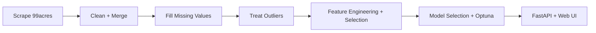
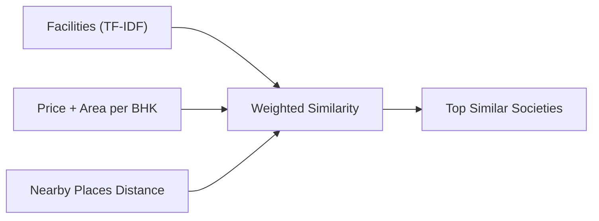

<div align="center">

# 🏙️ Gurgaon Property Price Predictor & Recommender

**An end-to-end machine learning project: from scraping 99acres listings to a live web app that predicts property prices and recommends similar societies.**


</div>

---

## 📌 Quick Navigation

[Overview](#-overview) · [Results](#-results-at-a-glance) · [Features](#-features) · [Pipeline](#-project-pipeline) · [Model Comparison](#-model-comparison) · [Recommender](#-recommendation-system) · [API](#-api-endpoints) · [Run Locally](#-run-it-locally) · [Structure](#-project-structure) · [Tech Stack](#-tech-stack)

---

## 🎯 Overview

Buying a property in Gurgaon is confusing: prices change a lot between sectors, sizes and furnishing. This project solves two problems:

| 💰 Price Prediction | 🏘️ Property Recommendation |
|---|---|
| Enter bedrooms, area, sector, furnishing, etc. and get an **estimated price range in ₹ Crore** | Search by **locality + radius** to find nearby societies, or click a society to see its **top similar societies** |

Everything is served through a **FastAPI backend** and a clean **light-theme web UI** (HTML, CSS, JS).

---

## 🏆 Results at a Glance

> Target = `log1p(price)`. Predictions are converted back with `expm1`, so **MAE is in ₹ Crore**.

| Metric | Baseline (Linear Regression) | Best Baseline (SVR) | ✅ Final Model (Tuned Random Forest) |
|---|:---:|:---:|:---:|
| **R² (accuracy)** | 0.8285 | 0.8977 | **0.9196** (10-fold CV) · **0.9124** (test set) |
| **MAE (loss)** | 0.7659 Cr | 0.5729 Cr | **0.4491 Cr** |

### 📉 How much did the loss drop?

| Compared with | MAE before | MAE after | Loss reduced by |
|---|:---:|:---:|:---:|
| First attempt (Linear Regression, Ordinal Encoding) | 1.1152 Cr | 0.4491 Cr | **≈ 59.7 %** |
| Baseline Linear Regression (One-Hot Encoding) | 0.7659 Cr | 0.4491 Cr | **≈ 41.4 %** |
| Best baseline model (SVR) | 0.5729 Cr | 0.4491 Cr | **≈ 21.6 %** |

### 📈 How much did the accuracy improve?

- **R² went from 0.8285 → 0.9196** (CV), an improvement of **+0.091 (about +9 percentage points)** over the Linear Regression baseline.
- The model explains **about 91% of the variation in property prices** on data it has never seen.

---

## ✨ Features

- 🔮 **Price prediction** from 13 property features across **108 Gurgaon sectors**
- 📍 **Locality search with autocomplete** and a radius filter (km)
- 🏢 **"Similar societies"** recommendations with a similarity score
- 🖼️ Photo and "See Property" link for each of the **635 societies**
- ⚡ FastAPI with **Pydantic validation**, so bad inputs are rejected with clear errors
- 📖 Auto-generated **Swagger docs** at `/docs`

---

## 🔄 Project Pipeline



<details>
<summary><b>📂 Click to see what each step does</b></summary>

| Step | Notebook folder | What was done |
|---|---|---|
| 1. Data cleaning | `Data Cleaning Notebooks/` | Cleaned flats and independent houses separately, then merged them (≈13.6k rows) |
| 2. Missing values | `Missing Value Imputation/` | Filled gaps in built-up area, floor, age of property and **facing direction** |
| 3. Outliers | `Outlier Treatment/` | Treated outliers in price, price per sq.ft, area, bedrooms, bathrooms |
| 4. EDA | `EDA Notebook/` | Univariate and multivariate analysis (price skewness ≈ 25.7, which is why the log transform is used) |
| 5. Feature engineering | `Feature Engineering/` | Built `servant_room`, `store_room`, `agePossession`, `furnishing_type`, `luxury_category`, `floor_category` from raw columns |
| 6. Feature selection | `Feature Selection/` | Compared **8 techniques**: correlation, Random Forest importance, Gradient Boosting importance, permutation importance, LASSO, RFE, linear weights, SHAP |
| 7. Modelling | `Model Training/` | Baseline, 12 models, 6 encoding strategies, Optuna tuning |
| 8. Recommender | `Model Training/Property Recomendation.ipynb` | TF-IDF and cosine similarity on 635 societies |

**Final dataset:** 13,134 properties (11,909 flats + 1,225 houses), price range ₹0.04 Cr to ₹45 Cr, median ₹2.03 Cr.

</details>

---

## 🤖 Model Comparison

### 1️⃣ Twelve models compared (best encoding: Mixed Encoding)

All models were tuned with **Optuna** and scored with 10-fold cross-validation.

| Rank | Model | R² | MAE (₹ Cr) |
|:---:|---|:---:|:---:|
| 🥇 | **ExtraTrees Regressor** | 0.9189 | 0.4629 |
| 🥈 | **Random Forest Regressor** | 0.9141 | 0.4677 |
| 🥉 | **XGBoost Regressor** | 0.9090 | 0.4968 |
| 4 | LightGBM Regressor | 0.9030 | 0.5300 |
| 5 | SVR | 0.8968 | 0.5468 |
| 6 | MLP Regressor | 0.8869 | 0.5591 |
| 7 | Decision Tree | 0.8386 | 0.6147 |
| 8 | Gradient Boosting | 0.8777 | 0.6204 |
| 9 | Linear Regression | 0.8264 | 0.7705 |
| 10 | Ridge | 0.8264 | 0.7713 |
| 11 | AdaBoost | 0.7642 | 0.8870 |
| 12 | Lasso | -0.0012 | 1.6829 |

### 2️⃣ Encoding strategies compared (best model of each)

| Encoding strategy | Best model | R² | MAE (₹ Cr) |
|---|---|:---:|:---:|
| Ordinal only | XGBoost | 0.9034 | 0.5192 |
| Ordinal + One-Hot | ExtraTrees | 0.9098 | 0.4841 |
| One-Hot + PCA | ExtraTrees | 0.9110 | 0.4789 |
| Target Encoding | Random Forest | 0.9118 | 0.4745 |
| **Mixed Encoding 1** (Ordinal + One-Hot + Target) ✅ | ExtraTrees | **0.9189** | **0.4629** |
| Mixed Encoding 2 | ExtraTrees | 0.9183 | 0.4653 |

> 💡 **Takeaway:** Tree ensemble models beat linear models by a big margin, and using the **right encoding per column** (ordinal for ordered categories, one-hot for direction/age, target encoding for the 108 sectors) gave the extra boost.

### 3️⃣ Hyperparameter tuning of the top 3 models

| Model | Optuna trials | Best CV R² | Best MAE (₹ Cr) |
|---|:---:|:---:|:---:|
| **Random Forest** ✅ | 35 | 0.9176 | **0.4516** |
| ExtraTrees | 30 | 0.9191 | 0.4633 |
| XGBoost | 100 | 0.9196 | 0.4732 |

Random Forest had the **lowest MAE**, so it was tuned further with **100 more Optuna trials** and evaluated **once** on a held-out test set:

| Final Random Forest | Value |
|---|---|
| CV R² (10-fold) | **0.9196** |
| Test R² (log scale) | **0.9124** |
| Test MAE | **₹ 0.4491 Cr** |

<details>
<summary><b>⚙️ Click to see the final hyperparameters</b></summary>

```python
RandomForestRegressor(
    bootstrap=False,
    n_estimators=750,
    max_depth=31,
    min_samples_split=3,
    min_samples_leaf=1,
    max_features=0.38,
    n_jobs=-1,
    random_state=42,
)
```

**Preprocessing (ColumnTransformer):**

| Type | Columns |
|---|---|
| StandardScaler | bedRoom, bathroom, built_up_area, servant_room, store_room |
| Ordinal | property_type, balcony, luxury_category, floor_category, furnishing_type, agePossession |
| One-Hot | sector, facing, agePossession |
| Target Encoding | sector |

</details>

---

## 🏘️ Recommendation System



Three cosine-similarity matrices are combined for **635 societies**:

| Matrix | Built from | Weight |
|---|---|:---:|
| `cosine_sim1` | Society facilities (TF-IDF, 1-2 grams) | **30** |
| `cosine_sim2` | Price and area per BHK type (one-hot + scaling) | **20** |
| `cosine_sim3` | Distance to nearby places (scaled) | **8** |

`final_score = 30 × sim1 + 20 × sim2 + 8 × sim3`

**Locality search:** a distance matrix (society × locality, in metres) returns all societies within the chosen radius, sorted by distance.

**Data prep for recommender:** 10,704 raw listings → 8,206 cleaned listings → **635 unique societies** (junk names removed, duplicates merged, rental listings dropped).

---

## 🔌 API Endpoints

| Method | Endpoint | Purpose |
|---|---|---|
| `GET` | `/api/sectors` | List of all sectors for the dropdown |
| `POST` | `/predict` | Predict the price range for a property |
| `GET` | `/api/localities?q=` | Locality autocomplete |
| `GET/POST` | `/api/recommend` | Societies within `radius_km` of a locality |
| `GET/POST` | `/api/similar` | Top-N similar societies for a given society |

<details>
<summary><b>🧪 Click for an example request</b></summary>

```bash
curl -X POST http://127.0.0.1:8000/predict \
  -H "Content-Type: application/json" \
  -d '{
    "bedRoom": 4,
    "bathroom": 3,
    "built_up_area": 2750,
    "servant_room": "No",
    "store_room": "No",
    "property_type": "House",
    "sector": "Sector 102",
    "balcony": "3+",
    "agePossession": "New Property",
    "furnishing_type": "Unfurnished",
    "luxury_category": "Low",
    "floor_category": "Low Floor",
    "facing": "North-East"
  }'
```

The model predicts about **₹ 3.61 Cr** for this property, and the API returns a price range around it.

</details>

---

## 🚀 Run It Locally

```bash
# 1. Clone
git clone https://github.com/<your-username>/<your-repo>.git
cd <your-repo>

# 2. Create a virtual environment
python -m venv venv
venv\Scripts\activate          # Windows
# source venv/bin/activate     # macOS / Linux

# 3. Install dependencies
pip install -r requirements.txt

# 4. Get the trained model (see note below)

# 5. Start the app
uvicorn main:app --reload
```

Open **http://127.0.0.1:8000** for the app and **http://127.0.0.1:8000/docs** for the Swagger UI.

> ⚠️ **About `house_price_model.pkl`:** the trained model is too large for GitHub, so it is **not included** in this repo.
> To generate it, open `Model Training/Model Selection.ipynb`, run it to the end, and the last cells save the model with
> `joblib.dump(best_pipeline, 'house_price_model.pkl', compress=3)`.
> Then place the file inside `price_prediction/` (next to `df.pkl`).

---

## 📁 Project Structure

```text
├── main.py                          # FastAPI app (API + static UI)
├── requirements.txt
├── static/
│   ├── index.html                   # UI (2 tabs: Price Prediction, Recommendation)
│   ├── style.css
│   └── app.js
├── price_prediction/
│   ├── predict_price_router.py      # /predict and /api/sectors
│   ├── df.pkl                       # feature data (sector list)
│   └── house_price_model.pkl        # trained model (not in repo, too large)
├── recomendation/
│   ├── recomendation_router.py      # /api/localities, /api/recommend, /api/similar
│   ├── cosine_sim1.pkl · cosine_sim2.pkl · cosine_sim3.pkl
│   ├── locality_df.pkl              # society-to-locality distances
│   ├── link_of_property_photo.pkl   # society photos
│   └── see_property_link.pkl        # 99acres links
├── Data/                            # raw, cleaned and final CSVs
├── Data Cleaning Notebooks/
├── Missing Value Imputation/
├── Outlier Treatment/
├── EDA Notebook/
├── Feature Engineering/
├── Feature Selection/
└── Model Training/                  # Baseline, Model Selection, Property Recomendation
```

---

## 🛠️ Tech Stack

| Area | Tools |
|---|---|
| Language | Python |
| Data | Pandas, NumPy, web scraping (99acres) |
| ML | scikit-learn, XGBoost, LightGBM, category_encoders, SHAP |
| Tuning | Optuna |
| Backend | FastAPI, Pydantic, Uvicorn |
| Frontend | HTML, CSS, JavaScript |
| Visualisation | Matplotlib, Seaborn |

---

## 🔭 Future Improvements

- [ ] Deploy on Render / Railway / Hugging Face Spaces
- [ ] Add SHAP explanations to show *why* a price was predicted
- [ ] Keep the data fresh with scheduled scraping
- [ ] Add a map view for the recommender

---

## 👤 Author

**Your Name**
[LinkedIn](https://linkedin.com/in/your-profile) · [GitHub](https://github.com/your-username) · your.email@example.com

⭐ If you like this project, please give it a star!